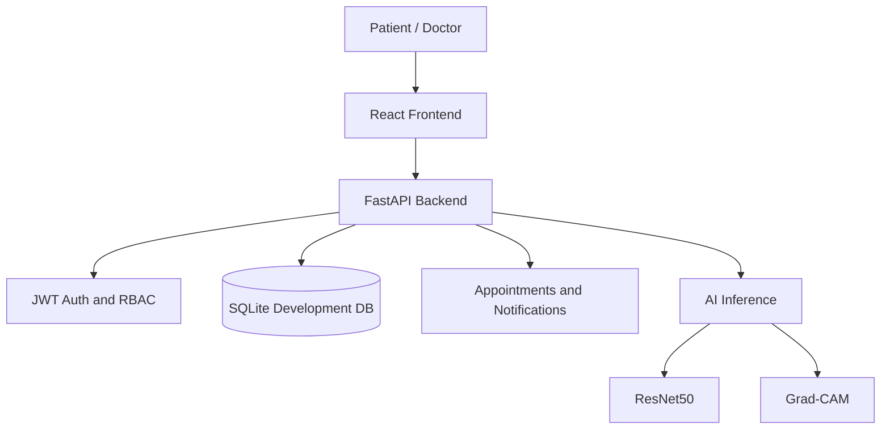

# Alzheimer's Disease Detection Platform

A research and education platform that combines four-class MRI image inference, Grad-CAM explainability, authenticated Patient and Doctor portals, appointment scheduling, and persistent care-team notifications.

> **Medical, model, and dataset disclaimer:** This is not a certified medical device and does not provide a diagnosis. The repository contains no authorized MRI evaluation samples; checkpoint provenance and training history are unverified. No accuracy or clinical-validity claim is asserted. Obtain authorized, consent-cleared data before evaluating model performance.

## Features

- Configured ResNet50 checkpoint inference across four class labels; availability depends on a valid checkpoint.
- Grad-CAM heatmaps and image overlays.
- Probability and confidence presentation.
- JWT authentication with Patient and Doctor roles.
- Doctor profiles and date-based availability slots.
- Patient appointment requests and duplicate-slot protection.
- Doctor approval and rejection workflows.
- Persistent notifications with unread and read states.
- Patient progress, reports, and authorized doctor notes.
- Responsive React interface with accessible route and dialog patterns.
- FastAPI OpenAPI documentation at `/docs`.

## Architecture



See [docs/architecture.md](docs/architecture.md) for the detailed Patient and Doctor workflows and production boundaries.

For a timed 4-6 minute presentation, use the [professional demo script](docs/demo-script.md).

## Technology

- Backend: Python, FastAPI, Pydantic, SQLite
- Frontend: React 18, TypeScript, Vite, Tailwind CSS
- AI: PyTorch, ResNet50, OpenCV, Pillow
- Testing: pytest, FastAPI TestClient
- Deployment targets: Render or Railway for the API, Vercel or a static host for the frontend

## Project structure

```text
backend/app/       FastAPI routes, auth, database, inference, Grad-CAM
backend/tests/     Automated API, role, appointment, and notification tests
frontend/src/      React application, portals, pages, API client
models/            Model metadata and documentation
backend/models/    Local model checkpoint storage
scripts/            Dataset and project validation utilities
data/              Local datasets, metadata, and SQLite database
reports/            Project reports and generated documentation
```

## Local installation

Verified runtime: Python 3.13.14, Node.js 24.20.0, and npm 11.19.0.

```powershell
py -3 -m venv .venv
.\.venv\Scripts\Activate.ps1
py -3 -m pip install -r requirements.txt
Copy-Item .env.example .env
Set-Location frontend
npm.cmd ci
Set-Location ..
```

Start the backend in one terminal (the local port matches the Vite API proxy):

```powershell
python run_backend.py
```

Start the frontend in a second terminal:

```powershell
Set-Location frontend
npm.cmd run dev -- --host 127.0.0.1 --port 5173
```

Open http://127.0.0.1:5173. The API is available at http://127.0.0.1:8001 and interactive API docs are at http://127.0.0.1:8001/docs.

## Environment variables

### Backend `.env`

| Variable | Purpose | Local default |
| --- | --- | --- |
| `APP_ENV` | Runtime environment; production requires explicit secrets and storage | `development` |
| `SECRET_KEY` | JWT signing secret; production requires at least 32 characters | development fallback only |
| `JWT_ALGORITHM` | JWT algorithm | `HS256` |
| `ACCESS_TOKEN_EXPIRE_MINUTES` | Token lifetime | `1440` |
| `CORS_ORIGINS` | Comma-separated allowed frontend origins | localhost Vite origins |
| `HOST` | Bind host | `127.0.0.1` |
| `PORT` | Hosting-provider port | `8001` |
| `ALZHEIMERS_DB_PATH` | SQLite file path; production must use persistent storage | project `data/app.db` |
| `MODEL_CHECKPOINT_PATH` | Optional model checkpoint override | `backend/models/resnet50_best.pth` |
| `MODEL_CHECKPOINT_SHA256` | Expected checkpoint SHA-256; required in production | unset |
| `MODEL_ARTIFACT_URL` | HTTPS URL for a private checkpoint artifact | unset |
| `MODEL_ARTIFACT_TOKEN` | Bearer token for the private artifact endpoint | unset |
| `MAX_UPLOAD_SIZE_BYTES` | Maximum uploaded image size | `10485760` (10 MiB) |
| `MAX_IMAGE_PIXELS` | Maximum decoded image dimensions | `20000000` |

In production, the checkpoint must match `MODEL_CHECKPOINT_SHA256`. If the file is not already on disk, configure both private artifact variables; provisioning uses HTTPS, bearer authentication, a size cap, and an atomic write. The checkpoint is unavailable if configuration, download, integrity, or loading checks fail.

Never commit `.env`, credentials, tokens, model weights, or uploaded medical data. `.env.example` is safe to copy and edit locally.

### Frontend `.env`

Local development uses the Vite proxy and does not require this variable. For a production build, set the absolute HTTPS backend API URL ending in `/api`:

```text
VITE_API_URL=https://your-api.example.com/api
```

The Vercel + Render configuration and required dashboard values are documented in [docs/DEPLOYMENT_RUNBOOK_VERCEL_RENDER.md](docs/DEPLOYMENT_RUNBOOK_VERCEL_RENDER.md).

## Workflows

### Patient

Patients can register or sign in, review model readiness, find a doctor, choose an available date and slot, request an appointment, and follow approval, rejection, and doctor-note notifications. Public registration creates patient accounts only.

### Doctor

Doctor workflows include profile management, availability, appointment review, notes, and authorized patient access. An authorized staff operator must verify credentials and provision accounts using `.\.venv\Scripts\python.exe scripts\provision_doctor.py`; this human review is recorded but is not automated.

## Testing

Run all backend tests from the project root:

```powershell
.\.venv\Scripts\python.exe -m pytest -q
```

Build the frontend:

```powershell
Set-Location frontend
npm.cmd run build
```

Validate supplied MRI data before making any model-performance claim:

```powershell
py -3 scripts/validate_mri_dataset.py
```

The validator must report real image samples in all four directories: `NonDemented`, `VeryMildDemented`, `MildDemented`, and `ModerateDemented`. It exits non-zero when coverage is missing.

## Deployment

The backend blueprint is in [render.yaml](render.yaml). The frontend SPA rewrite is in [frontend/vercel.json](frontend/vercel.json). Review the [Vercel + Render runbook](docs/DEPLOYMENT_RUNBOOK_VERCEL_RENDER.md), [environment-variable reference](docs/DEPLOYMENT_ENVIRONMENT_VARIABLES.md), and [deployment blockers](docs/DEPLOYMENT_BLOCKERS.md) before deployment.

The backend health endpoints are `/health` and `/api/predict/health`. The application logs request status, startup, shutdown, and unhandled errors without logging tokens or request bodies.

## Screenshots

The live application includes dashboard, appointment, notification, prediction, and Grad-CAM screens. Generated Grad-CAM artifacts are served locally under `/api/results`; capture deployment-specific screenshots after supplying authorized MRI samples. No clinical MRI screenshot is included in this repository so that the project does not imply unsupported medical validation.

## Safety

AI output is research support only. Do not use predictions, probabilities, or Grad-CAM visualizations to diagnose, triage, or select treatment. Protect patient data, use HTTPS, rotate secrets, restrict CORS to known origins, keep logs free of medical content, and obtain institutional approval for any real dataset.
