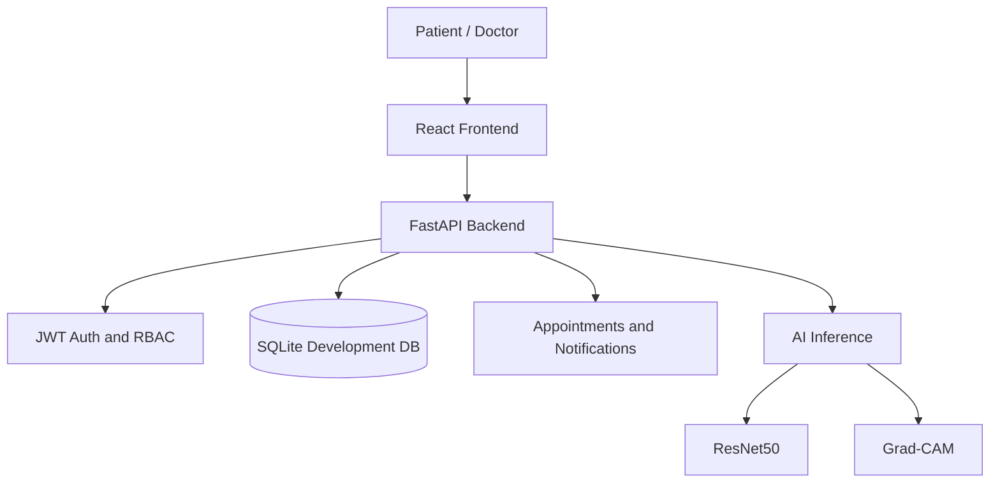

# Alzheimer's Disease Detection Platform

A research and education platform that combines four-class MRI image inference, Grad-CAM explainability, secure Patient and Doctor portals, appointment scheduling, and persistent care-team notifications.

> **Medical and dataset disclaimer:** This is not a certified medical device and does not provide a diagnosis. The repository does not contain legitimate MRI samples and has not claimed four-class clinical validation. Obtain authorized, consent-cleared data before evaluating or deploying model performance.

## Features

- ResNet50 inference across four configured classes.
- Grad-CAM heatmaps and image overlays.
- Probability and confidence presentation.
- JWT authentication with Patient and Doctor roles.
- Doctor profiles and date-based availability slots.
- Patient appointment requests and duplicate-slot protection.
- Doctor approval and rejection workflows.
- Persistent notifications with unread and read states.
- Patient progress, reports, and authorized doctor notes.
- Responsive React interface with accessible route and dialog patterns.
- FastAPI OpenAPI documentation at `/docs`.

## Architecture



See [docs/architecture.md](docs/architecture.md) for the detailed Patient and Doctor workflows and production boundaries.

For a timed 4-6 minute presentation, use the [professional demo script](docs/demo-script.md).

## Technology

- Backend: Python, FastAPI, Pydantic, SQLite
- Frontend: React 18, TypeScript, Vite, Tailwind CSS
- AI: PyTorch, ResNet50, OpenCV, Pillow
- Testing: pytest, FastAPI TestClient
- Deployment targets: Render or Railway for the API, Vercel or a static host for the frontend

## Project structure

```text
backend/app/       FastAPI routes, auth, database, inference, Grad-CAM
backend/tests/     Automated API, role, appointment, and notification tests
frontend/src/      React application, portals, pages, API client
models/            Model metadata and documentation
backend/models/    Local model checkpoint storage
scripts/            Dataset and project validation utilities
data/              Local datasets, metadata, and SQLite database
reports/            Project reports and generated documentation
```

## Local installation

Requirements: Python 3.13+, Node.js 18+, and npm.

```powershell
py -3 -m venv .venv
.\.venv\Scripts\Activate.ps1
py -3 -m pip install -r requirements.txt
Copy-Item .env.example .env
Set-Location frontend
npm.cmd ci
Set-Location ..
```

Start the backend in one terminal:

```powershell
py -3 -m uvicorn backend.app.main:app --host 127.0.0.1 --port 8000
```

Start the frontend in a second terminal:

```powershell
Set-Location frontend
npm.cmd run dev -- --host 127.0.0.1 --port 5173
```

Open http://127.0.0.1:5173. The API is available at http://127.0.0.1:8000 and interactive API docs are at http://127.0.0.1:8000/docs.

## Environment variables

### Backend `.env`

| Variable | Purpose | Local default |
| --- | --- | --- |
| `SECRET_KEY` | JWT signing secret; use a long random production value | generated fallback |
| `JWT_ALGORITHM` | JWT algorithm | `HS256` |
| `ACCESS_TOKEN_EXPIRE_MINUTES` | Token lifetime | `1440` |
| `CORS_ORIGINS` | Comma-separated allowed frontend origins | localhost Vite origins |
| `HOST` | Bind host | `0.0.0.0` |
| `PORT` | Hosting-provider port | `8000` |
| `DATABASE_URL` | Deployment database declaration | SQLite local path |

Never commit `.env`, credentials, tokens, or uploaded medical data. `.env.example` is safe to copy and edit locally.

### Frontend `.env`

Set `VITE_API_URL=/api` when a reverse proxy serves the API under the same origin. For a separately hosted API, set it during the Vite build:

```text
VITE_API_URL=https://your-api.example.com/api
```

## Workflows

### Patient

Register or sign in, review model readiness, find a doctor, choose an available date and slot, request an appointment, and follow approval, rejection, and doctor-note notifications. MRI results and Grad-CAM outputs are available from the analysis and explainability pages.

### Doctor

Register or sign in, complete the professional profile, publish bookable slots, review requests, approve or reject appointments, view authorized patients, add notes, and run analysis only for an authorized patient relationship.

## Testing

Run all backend tests from the project root:

```powershell
pytest -q
```

Build the frontend:

```powershell
Set-Location frontend
npm.cmd run build
```

Validate supplied MRI data before making any model-performance claim:

```powershell
py -3 scripts/validate_mri_dataset.py
```

The validator must report real image samples in all four directories: `NonDemented`, `VeryMildDemented`, `MildDemented`, and `ModerateDemented`. It exits non-zero when coverage is missing.

## Deployment

The backend blueprint is in [render.yaml](render.yaml). The frontend SPA rewrite is in [frontend/vercel.json](frontend/vercel.json). Follow [docs/deployment.md](docs/deployment.md) for Render, Railway, Vercel, environment variables, health checks, logging, CORS, and the current SQLite-to-PostgreSQL production boundary.

The backend health endpoints are `/health` and `/api/predict/health`. The application logs request status, startup, shutdown, and unhandled errors without logging tokens or request bodies.

## Screenshots

The live application includes dashboard, appointment, notification, prediction, and Grad-CAM screens. Generated Grad-CAM artifacts are served locally under `/api/results`; capture deployment-specific screenshots after supplying authorized MRI samples. No clinical MRI screenshot is included in this repository so that the project does not imply unsupported medical validation.

## Safety

AI output is research support only. Do not use predictions, probabilities, or Grad-CAM visualizations to diagnose, triage, or select treatment. Protect patient data, use HTTPS, rotate secrets, restrict CORS to known origins, keep logs free of medical content, and obtain institutional approval for any real dataset.
