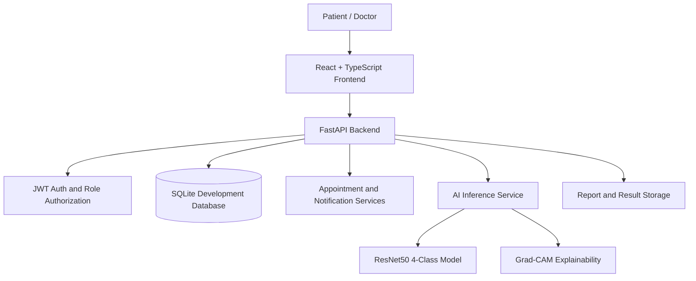

# System Architecture

## Runtime flow

For production, replace the development SQLite deployment with a managed PostgreSQL adapter and versioned migrations before running multiple workers.

## Patient workflow

1. Register or sign in as a patient.
2. Review the dashboard and model readiness.
3. Find a doctor by city or specialization.
4. View published dates and available time slots.
5. Request an appointment.
6. Receive appointment approval, rejection, and doctor-note notifications.
7. Review appointments, progress, reports, prediction probabilities, and Grad-CAM output.

## Doctor workflow

1. Register or sign in as a doctor.
2. Complete the professional profile.
3. Publish date-based availability in 15, 30, or 60 minute slots.
4. Review patient appointment requests.
5. Approve or reject requests.
6. Review authorized patients and add notes.
7. Run MRI analysis for patients with an authorized appointment relationship.

## Backend boundaries

- `backend/app/main.py` owns application startup, CORS, request logging, route registration, and health endpoints.
- `backend/app/api/routes/auth.py` owns registration, login, and account operations.
- `backend/app/api/routes/portal.py` owns doctors, availability, appointments, notes, and notifications.
- `backend/app/api/routes/prediction.py` owns model readiness, prediction, and Grad-CAM requests.
- `backend/app/core/database.py` initializes the local SQLite schema and compatible additions.
- `backend/app/ml/` contains inference, model loading, preprocessing, and explainability code.

## API documentation

When the backend is running, interactive OpenAPI documentation is available at `/docs`, with the schema at `/openapi.json`. The primary API groups are authentication, models, prediction, analysis, reports, and the patient-doctor portal.

## Data and safety

The model recognizes four configured labels: `NonDemented`, `VeryMildDemented`, `MildDemented`, and `ModerateDemented`. The repository currently contains no legitimate MRI image samples, so four-class dataset validation has not been claimed. Use `py -3 scripts/validate_mri_dataset.py` before evaluating supplied, authorized data.
